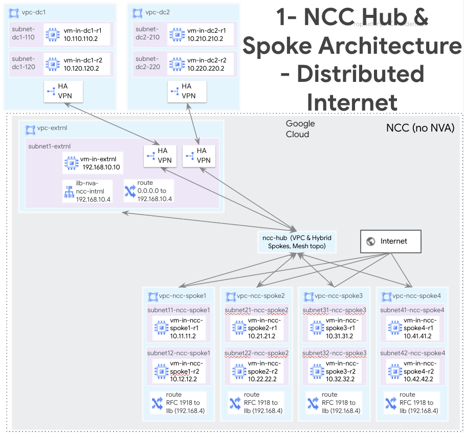
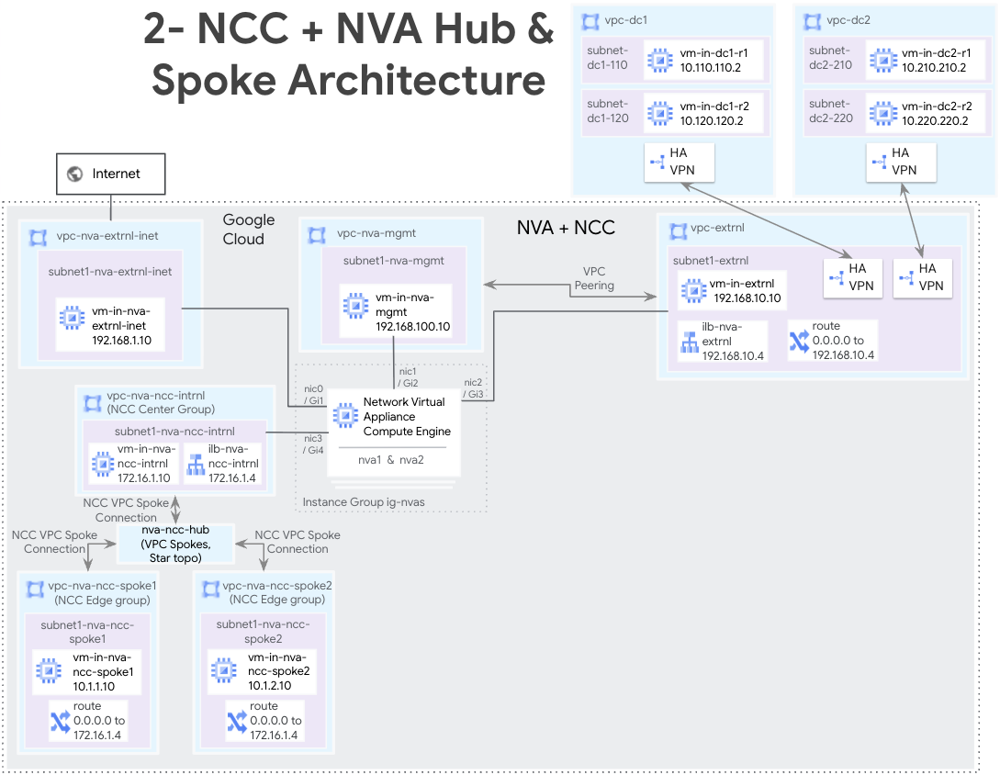
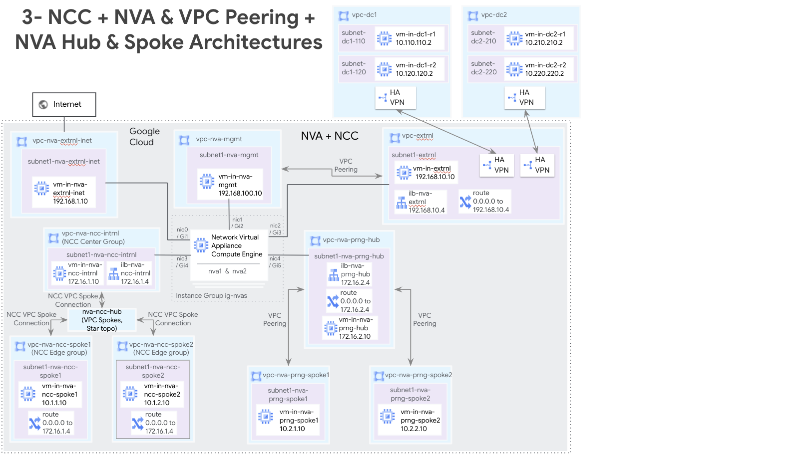
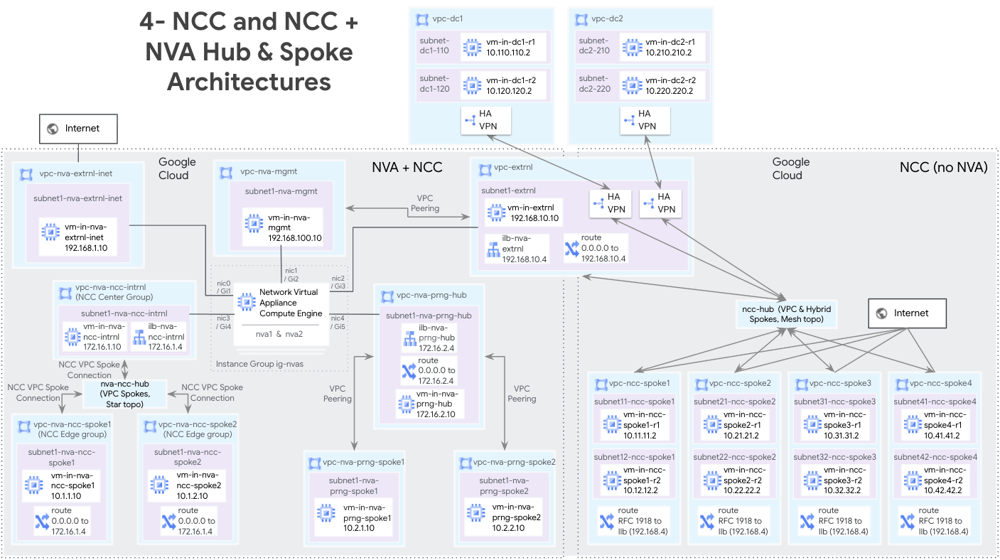

# Automate hub and spoke with NCC and NVAs for Google Cloud demos, pilots, and learning

With a few settings you can create a variety of hub and spoke patterns including Network Connectivity Center (NCC) and a fully configured pair of Network Virtual Appliances (NVAs). Here are the options: 









Note: Options 3 and 4 are purposely overbuilt. They build a variety of architectural options in the same architecture, perhaps to model migrations. Your production architecture would likely align closer to Options 1 or 2.

The Network Virtual Appliances (NVAs) used in the script are Cisco Cloud Services Routers (CSRs). Future versions of the script may add modularity and standard Terraform practices if they are needed, though the intent of the script is to create a fixed environment for learning and demonstration, **not production**.


## Capabilities that can be demonstrated

* Integration between NCC, VPC Peering and NVAs
* Routing between a pure NCC environment (no NVAs) and an environment with NVAs, NCC and VPC Peering
* Internal network load balancer as a Next Hop, including integration with NCC
* Redundant pair of NVAs fully configured
* Hub and spoke environment with multiple hubs and multiple spokes
* Failing/rebooting an NVA while routing automatically recovers
* Simulated connections to on-prem Data Centers using VPCs and HAVPN between VPCs


## Process to run the script

* Create 1 project in GCP, if not already created. All GCP resources are created in the same project. Reference if needed [Creating and managing projects ](https://cloud.google.com/resource-manager/docs/creating-managing-projects)
* Access the Google Cloud command line (in Cloud Shell or gcloud on your machine). Reference if needed [Launch Cloud Shell](https://cloud.google.com/shell/docs/launching-cloud-shell)
* At the command prompt run gcloud config set project <project_id> . Reference if needed for how to find project ID, see [Find the project name, number, and ID](https://cloud.google.com/resource-manager/docs/creating-managing-projects#identifying_projects)
* In Google Cloud Shell Clone this repo: `git clone https://github.com/kurtradecki/gcp-ncc-full-demo.git` Reference if needed [Clone a repository](https://cloud.google.com/shell/docs/version-control#clone_a_repository)
* Note: Needed APIs are enabled and Org policies are set in the script, so you'll need permissions to set those
* Copy exmaple.tfvars (can use [cp command](https://www.geeksforgeeks.org/linux-unix/cp-command-linux-examples/)) to terraform.tfvars and add values in terraform.tfvars such as project_id. Reference if needed for how to find project ID, see [Find the project name, number, and ID](https://cloud.google.com/resource-manager/docs/creating-managing-projects#identifying_projects)
* At the command prompt run the following terraform commands:
  * `terraform init`
  * `terraform plan`
  * `terraform apply -auto-approve`

## Test reachability throuhgout the environment

Wait ~9 minutes and your environment will be ready to explore. Below is a bash script to test reachability from any host. Before running the script, set the relevant IP addresses based on the environment you built: 

Option 1: `IP_LIST="192.168.10.10 10.110.110.2 10.120.120.2 10.210.210.2 10.220.220.2 10.11.11.2 10.12.12.2 10.21.21.2 10.22.22.2 10.31.31.2 10.32.32.2 10.41.41.2 10.42.42.2 8.8.8.8"`

Option 2: `IP_LIST="172.16.1.10 10.1.1.10 10.1.2.10 192.168.10.10 10.110.110.2 10.120.120.2 10.210.210.2 10.220.220.2 8.8.8.8"`

Option 3: `IP_LIST="172.16.1.10 10.1.1.10 10.1.2.10 172.16.2.10 10.2.1.10 10.2.2.10 192.168.10.10 10.110.110.2 10.120.120.2 10.210.210.2 10.220.220.2 8.8.8.8"`

Option 4: `IP_LIST="172.16.1.10 10.1.1.10 10.1.2.10 172.16.2.10 10.2.1.10 10.2.2.10 192.168.10.10 10.110.110.2 10.120.120.2 10.210.210.2 10.220.220.2 10.11.11.2 10.12.12.2 10.21.21.2 10.22.22.2 10.31.31.2 10.32.32.2 10.41.41.2 10.42.42.2 8.8.8.8"`


Bash script:
```
    for ip in $IP_LIST; do
        ping -c 1 -W 0.5 "$ip"
    done | awk '
    /ping statistics/ {ip=$2} 
    /packet loss/ {
        for(i=1;i<=NF;i++) {
            if($i == "100%") {
                if (failed == 0) {
                    print "*** ALERT: The following hosts failed: ***"
                }
                print ip, $i, "packet loss"
                failed++
            }
        }
    }
    END {
        if (failed == 0) {
            print "*** SUCCESS: All pings were successful! ***"
        }
    }'
```

## Note about the script and environment

* Network Virtual Appliance (NVA) can be accessed via console. Select an NVA VM in the GCP console and press the "CONNECT TO SERIAL CONSOLE" button.
* Network Virtual Appliance (NVA) credentials, username: consoleadmin, password: google123 
* No Cloud NAT for untrusted VPCs and routing not allowed through appliances from untrusted to any of the other VPCs, so traffic sourced from vm-untrusted will fail to reach other hosts. This VM is to test reachability from other VPCs to it. 
* By design vm-management is isolated and only able to reach the NVAs. 


## Conclusion & Cleanup

Congratulations! You've successfully deployed the script.

To delete the created infrastructure, run the following command:

```sh
terraform destroy -auto-approve
```

Wait a few minutes for the components created by the Terraform script to be removed. You'll see a message similar to "Destroy complete!" 
