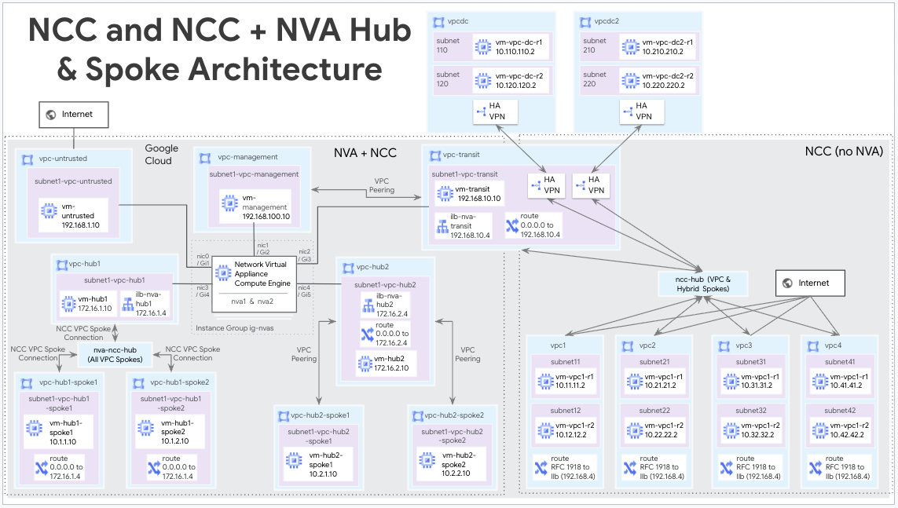

# Automate hub and spoke with NCC and network virtual appliances for Google Cloud demos, pilots, and learning

With a few settings you can create the following hub and spoke environment with full Google Cloud network setup and a fully configured pair of Network Virtual Appliances (NVAs) for learning a variety of separate though common Google Cloud network patterns all in 1 architecture build. 


Note: This architecture is purposely overbuilt. It provides a way to build a variety of architectural options built in the same architecture. Your production architecture would likely be much more simplified than the diagram above.

The NVAs used in the script are Cisco Cloud Services Routers (CSRs). Future versions of the script may add modularity and standard Terraform practices if they are needed, though the intent of the script is to create a fixed environment for learning and demonstration, **not production**.

Capabilities that can be demonstrated:
* Integration between NCC, VPC Peering and NVAs
* Routing between a pure NCC environment (no NVAs) and an environment with NVAs, NCC and VPC Peering
* Internal network load balancer as a Next Hop, including integration with NCC
* Redundant pair of NVAs fully configured
* Hub and spoke environment with multiple hubs and multiple spokes
* Failing/rebooting an NVA while routing automatically recovers
* Simulated connections to on-prem Data Centers using VPCs and HAVPN between VPCs


Process to run the script:
* Create a project in GCP, if not already created. Reference if needed [Creating and managing projects ](https://cloud.google.com/resource-manager/docs/creating-managing-projects)
* Access the Google Cloud command line (in Cloud Shell or gcloud on your machine). Reference if needed [Launch Cloud Shell](https://cloud.google.com/shell/docs/launching-cloud-shell)
* At the command prompt run gcloud config set project <project_id> . Reference if needed for how to find project ID, see [Find the project name, number, and ID](https://cloud.google.com/resource-manager/docs/creating-managing-projects#identifying_projects)
* In Google Cloud Shell Clone this repo. Reference if needed [Clone a repository](https://cloud.google.com/shell/docs/version-control#clone_a_repository)
* Note: APIs are enabled and Org policies are set in the script, so you'll need permissions to set those
* Copy exmaple.tfvars (can use [cp command](https://www.geeksforgeeks.org/linux-unix/cp-command-linux-examples/)) to terraform.tfvars and add values in terraform.tfvars such as project-id. Reference if needed for how to find project ID, see [Find the project name, number, and ID](https://cloud.google.com/resource-manager/docs/creating-managing-projects#identifying_projects)
* At the command prompt run the following terraform commands:
  * `terraform init`
  * `terraform plan`
  * `terraform apply -auto-approve`

Wait ~9 minutes and your environment will be ready to explore. Here's a bash script to test reachability to the rest of the environment from any host: 
```
IP_LIST="172.16.1.10 10.1.1.10 10.1.2.10 172.16.2.10 10.2.1.10 10.2.2.10 192.168.10.10 10.110.110.2 10.120.120.2 10.210.210.2 10.220.220.2 10.11.11.2 10.12.12.2 10.21.21.2 10.22.22.2 10.31.31.2 10.32.32.2 10.41.41.2 10.42.42.2 8.8.8.8"
    for ip in $IP_LIST; do
        ping -c 1 -W 0.5 "$ip"
    done | awk '
    /ping statistics/ {ip=$2} 
    /packet loss/ {
        for(i=1;i<=NF;i++) {
            if($i == "100%") {
                if (failed == 0) {
                    print "*** ALERT: The following hosts failed: ***"
                }
                print ip, $i, "packet loss"
                failed++
            }
        }
    }
    END {
        if (failed == 0) {
            print "*** SUCCESS: All pings were successful! ***"
        }
    }'
```

Notes about the script and environment:
* Network Virtual Appliance (NVA) can be accessed via console. Select an NVA VM in the GCP console and press the "CONNECT TO SERIAL CONSOLE" button.
* Network Virtual Appliance (NVA) credentials, username: consoleadmin, password: google123 
* No Cloud NAT for untrusted VPCs and routing not allowed through appliances from untrusted to any of the other VPCs, so traffic sourced from vm-untrusted will fail to reach other hosts. This VM is to test reachability from other VPCs to it. 
* By design vm-management is isolated and only able to reach the NVAs. 
